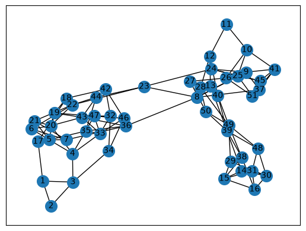
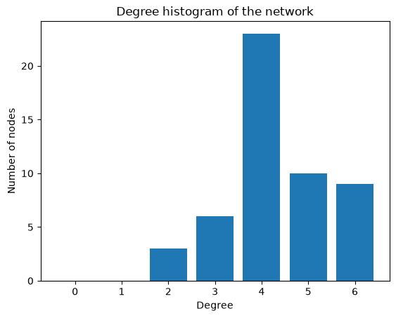
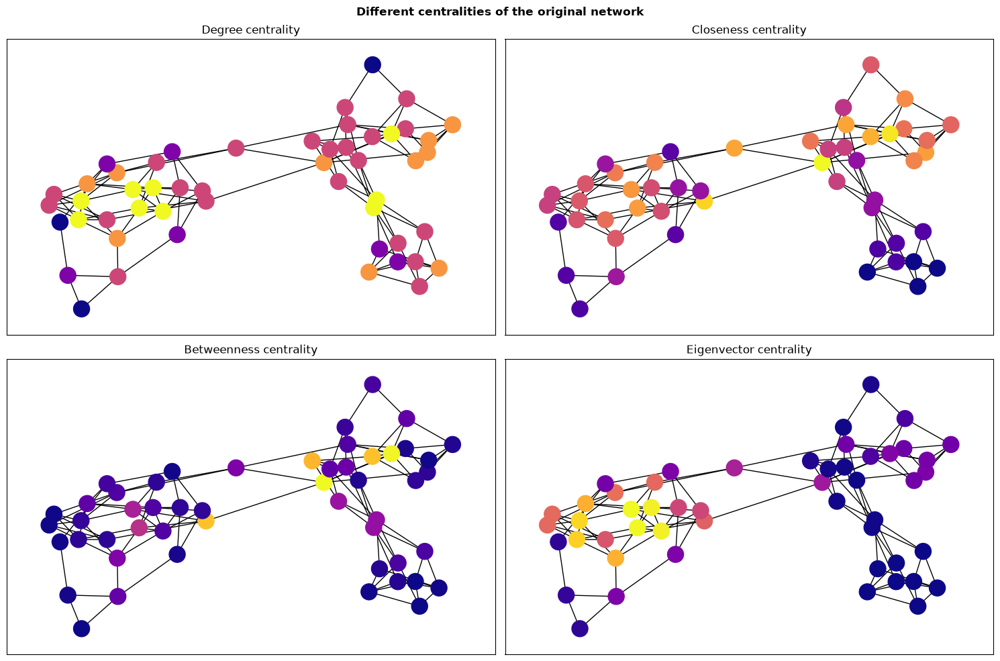

# Network Analysis Report  
## A Network Science Study Assignment  
by [@CatrinaB](https://github.com/CatrinaB)

### Introduction

This report describes my analysis of the provided network.

The network represents the structure of an enzyme; the nodes are the atoms it is composed of, and the edges are the interactions (chemical or physical) that exist between those atoms. [Figure 1](#fig-graph) is a visual representation of the network. 

*Figure 1. A visual representation of the network.*

**Note**: The representation used throughout this report is obtained using the `spring_layout` function with seed = 2 and 20 iterations.

### Basic properties of the network

First, I analysed the network from a topological perspective; the results are in [Table 1](#table-properties).

| Property | Value |
| --- | ------ |
| Number of nodes (N) | 51 |
| Number of edges (L) | 110 |
| Average Degree <k> | 4.3137|
| Network Density | 0.086275 |
| Connected Components | 1 |
| Component Size | 51 nodes |
| Average Path Length | 5.0424 |
| Network Diameter | 12 |

*Table 1. Basic topological properties of the network*

Afterwards, I computed the histogram of the network's degree distribution ([Figure 2](#fig-histogram)). It is obvious that the network is not scale-free, because it does not have a heavy-tailed distribution.  
**Note**: while a histogram is generally not a good representation of the degree distribution, due to the small range of degree values, it is more representative for this network.

*Figure 2. Histogram of the network's degree distribution*

### Higher-order properties of the network
#### Clustering, assortativity, and network randomisation

To explore whether the network's properties are a result of its degree distribution or of another phenomenon, I created a new network using the `nx.random_reference` function with a seed of 15. I then calculated the global clustering and the assortativity coefficient for both; the difference was significant: $0.237908$ vs. $0.030719$ for clustering and $0.169262$ vs. $0.057926$ for assortativity. This prompted me to investigate if the findings are statistically significant, so I calculated the mean and standard deviation for both coefficients across 1000 variations of network randomisation. The final results show a $z$-score of $8.08$ for the clustering coefficient, proving that it is a significant structural property of the network. The assortativity had a $z$-score of $1.91$, remaining on the boundary of statistical significance.

These results also highlight that the network has a **small-world property**: high clustering with short average paths. While the average path length is higher than that of a random network, it is still short enough to allow for the property to hold.

#### Average Nearest Neighbour Degree (ANND)
Plotting the ANND shows that the network has an assortative tendency, meaning it tends to organise itself into hubs.

#### Centrality

[Figure 3](#fig-centralities) shows the degree, closeness, betweenness, and eigenvector centralities of the network. Investigating them revealed that the network has a dense, self-reinforcing core, a centralised information flow, and a vulnerable structure: eliminating only two nodes (25 and 35 or 8 and 26) severely disrupts the network's ability to disseminate information from its central nodes to the periphery and metaphorically splits it into two components, one with only a few very important nodes, and one with many unimportant ones.

A more detailed analysis is available in the [Network_Analysis_notebook.ipynb](https://github.com/CatrinaB/Network-Science-Assignment/blob/main/Network_Analysis_notebook.ipynb) file.

*Figure 3. The degree, closeness, betweenness, and eigenvector centralities of the network*

### Communities
#### Louvain vs. fast greedy
Applying the Louvain and the fast greedy algorithms to the network showed that, if the Louvain method reaches the same number of communities as the fast greedy one, i. e. four, the communities are almost identical, with the exception of node 11. However, as the Louvain algorithm is non-deterministic, it sometimes divides the network in five communities, in which case half of the nodes of the two communities on the left side of the network form a new community of their own.

Both algorithms return a high modularity ($Q \approx 0.62$), indicating a strong community structure.

#### Communities and local clustering
Comparing the resulting communities with the clustering coefficient of each node, a trend became apparent: the nodes which are usually gateways between communities, i. e., are at the edge of their community and have at least a link to a node in another community, tend to have a low (or lower) clustering coefficient.

